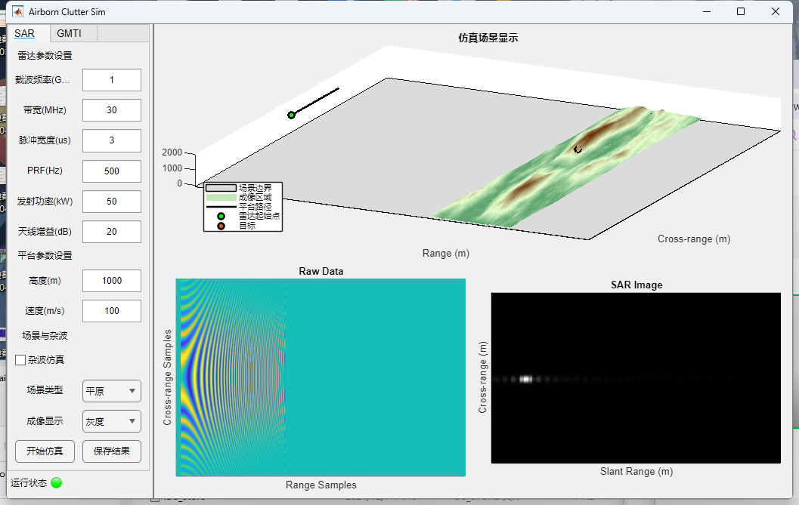

# Airborne SAR Clutter Simulation Tool: A Comprehensive Analysis from the Interface to the Principles with MATLAB Code Included

1. First, look at the interface: parameters + display, with a clear layout that can be operated with "foolish-style" 🖥️ This app's interface is a typical "control + display" layout, which is very intuitive to use:
Left: The "Control Center" panel is divided into SAR and GMTI (GMTI functionality is not yet implemented) using Tab labels, with core operations located within the SAR tab.
•  
Radar Parameter Area: Carrier Frequency, Bandwidth, Pulse Width, PRF (Pulse Repetition Frequency) and other radar core parameters, can be adjusted directly by entering the numerical values.
•  
Platform parameter area: Set the height and flight speed of the carrier.
•  
Scene Clutter Area: Selectable "Plain / Mountainous / Urban" scenes, and also check "Clutter Simulation" to simulate interference in real environments. Imaging display supports "Grayscale / Color" switching.
•  
Bottom button: "Start Simulation" to initiate the process, "Save Results" to store data; there's also a running status light (red = running, green = completed), making the status clear at a glance.
Right: "Result Dashboard" panel divided into three display areas using a grid layout.
•  
Above: 3D simulation scene (see terrain undulations, carrier aircraft flight trajectory, target position);
•  
Below left: Original echo data (the real part of the IQ signal received by radar, which is a bunch of striped waveforms);
•  
Below right: SR imaging results (final image after echo processing, clearly visible target).
Moreover, when the window width narrows, the interface will automatically switch to "vertical layout," achieving full adaptive effect.
II. Code Design: Modularity is the soul of "good code" 🧩 This app was written using MATLAB App Designer, and the code structure fully adheres to the "modularity" approach, making it easy for even beginners to follow the logic:
1. Class Structure: Inheriting the App Designer specification to define the class as SAR_Clutter < matlab.apps.AppBase, with three types of attributes and three types of methods.
•  
Component Attributes: Store all interface elements (such as buttons, input boxes, displaying coordinate axes), convenient for instant call / modification of the interface.
•  
Functional Attributes: Store simulation parameters (such as carrier frequency, terrain data), intermediate results (such as raw echoes, imaging maps), are the data carriers of functional modules.
•  
Method:
•  
Public methods: Implement core functionalities (such as generating terrain with RandomTerrainGenerator, plotting ground truth with PlotGroundTruth);
•  
Private callback: respond to interface operations (such as "Start Simulation" triggering the StartBtn function);
•  
Component creation / startup: createComponents initializes all interface elements, and startupFcn initializes parameters and generates initial terrain at the time of App launch.
2. Core Function Method: Break complex processes into "small modules" such as the RandomTerrainGenerator for generating terrain, using an iterative refinement + random perturbation approach to create natural terrain.
•  
Firstly, divide the large grid and assign initial heights.
•  
Each iteration refines the grid further and adds random perturbations.
•  
Finally, ensure the terrain height is not less than 0 - this will allow for the simulation of "plains (disturbed small)" and "mountains (disturbed large)" differences.
III. How is SAR Simulation Running? Breakdown of the Core Processes🎯The essence of this App is to translate the "physical processes" of SAR simulation into code logic, with a core process consisting of six steps:
1. Initialization of parameters
When the app starts, it automatically reads the default values from the interface (e.g. Carrier frequency 1GHz, Bandwidth 30MHz), calculates derived parameters (e.g. Wavelength = Speed of Light / Frequency), and sets scene parameters such as terrain range and initial altitude.

2. Generating random terrain
The Random Terrain Generator is called to iterately generate terrain grid data with random perturbations, preparing for subsequent scene display.

3. Building radar scenarios
Using MATLAB's radarScenario, a "virtual airspace" is created:
- Load the platform: Set the takeoff point (0,0,1000m) and flight speed (100m/s);
- Add targets: Place a target with RCS (Radar Cross Section) on the terrain;
- Add radar sensors: Configure hardware parameters such as LFM waveform (linear frequency modulation waveform, commonly used in SAR), transmit power, antenna gain, etc.

4. Acquiring echo signals
After clicking "Start Simulation," the carrier aircraft flies with the radar, emitting an LFM waveform while receiving the echo signals from the target + clutter, which are the "raw IQ data" and will be displayed in real-time on the left side of the raw data graph.

5. SAR imaging processing
Use the range migration algorithm (rangeMigrationLFM) to process the raw echoes - this is the core of SAR imaging: converting time-domain echo signals into a two-dimensional image in space domain, ultimately displayed on the right side of the SAR imaging graph.

6. Results saving
After simulation completion, click "Save Results" to save the "raw echo + SAR imaging graph" as a MAT file, allowing for direct retrieval and analysis later.

IV. Summary: The advantages of turning complex simulations into a "visualization tool" for this App are clear:
- Code level: A clear modular structure, with core functions divided into independent methods, making changes to parameters or adding features without affecting the overall system.
•  
Interface level: Interactively friendly, parameter classification clear, results visualization intuitive;
•  
Principle level: Completely covers the core process of SAR simulation, which is a "living textbook" for learning SAR principles.
If you are also involved in radar / remote sensing research, it would be a good idea to follow this approach and build your own simulation tool.
End

## Images

<!-- PAYMENT_BLOCK -->

## Get this dataset

- Payment link (Stripe): [Buy now](https://buy.stripe.com/3cs8yP7sY87d0vu9AB)
- Payment QR code: 

<!-- /PAYMENT_BLOCK -->
